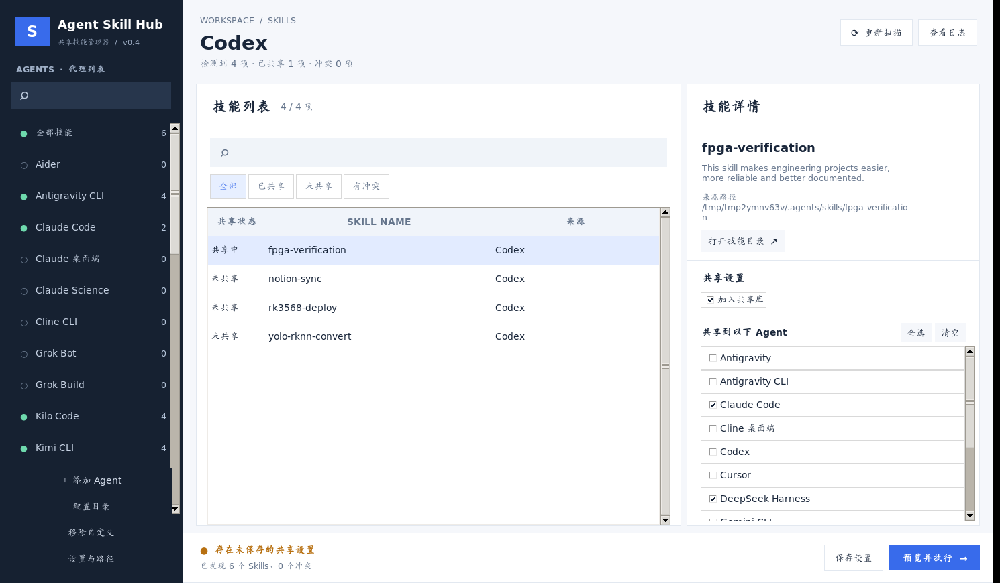

# Agent Skill Hub

**Windows 桌面端的多 Agent 技能（SKILL.md）共享管理器** —— 在 Codex、Claude Code、Cursor、Gemini CLI、DeepSeek Harness 等数十种 AI Agent 客户端之间，安全地扫描、去重、汇总并按需分发本地技能。

- 纯 Python 标准库 + Tkinter，**无需 pip 安装任何第三方依赖**，全程离线运行
- Microsoft Fluent 2 风格的三栏桌面界面：Agent 导航 / 技能清单 / 定向共享设置
- **暂存式编辑 + 变更预览 + 最终确认**：未经你确认，绝不改动文件系统
- 只复制缺失技能、用 Windows Junction 定向安装、只撤销本工具创建的链接，**永不覆盖或删除原始技能**




> 上图为模拟技能数据下的界面：左侧 Agent 导航、中央技能表格与筛选、右侧单个技能的共享范围设置，底部为暂存状态与操作栏。

## 它解决什么问题

不同 AI Agent 客户端各自维护自己的本地技能目录（如 `.agents/skills`、`.claude/skills`、`.cursor/skills`、`.gemini/skills`……）。同一份技能往往散落在多处、版本各异，手动复制又容易覆盖个人定制内容。

Agent Skill Hub 把分散的技能统一汇总到一个**共享库**（默认 `D:\AI-Skills\skills`），再通过目录联接（Junction）把技能**定向安装**给你指定的 Agent：

- 同名同内容的技能自动去重，只保留一份共享副本；
- 同名但内容不同的版本标记为**冲突**，绝不猜测取舍、绝不删除任何一方；
- 每个技能可以单独选择接收的 Agent，支持多选批量操作；
- 撤销共享时只移除本工具登记过的链接，共享库副本和原始技能均保留。

## 功能一览

**Agent 管理**

- 内置 **34 个 Agent 条目**：13 个有官方文档路径、客户端存在时自动扫描；21 个仅提供手动配置入口（列表中存在不代表该产品支持本地技能）
- 支持 **DeepSeek Harness**（`.dsh/skills`，识别 `DSH_HOME` 环境变量）与通用 `.agents/skills` 读取方
- 手动登记自定义 Agent、为内置 Agent 配置真实的本地技能根目录、额外扫描指定项目内的技能目录
- 左侧按名称 / 内部 ID 搜索 Agent，显示每个 Agent 当前可见的技能数量

**技能管理**

- 按技能名 / 来源搜索（`Ctrl+F`），按全部 / 已共享 / 未共享 / 有冲突筛选
- 右侧详情面板展示技能描述、来源路径，可一键打开技能目录
- `Ctrl` / `Shift` 多选技能，批量设置相同接收范围或批量取消共享
- 自动去重；三类冲突检测：同名异版本、共享库版本冲突、目标目录同名占用

**安全的共享流程**

- 勾选操作先进入**暂存区**（内存中），底部黄色提示未保存变更
- `保存设置`（`Ctrl+S`）仅保存共享策略，不产生任何文件改动
- `预览并执行` 逐条列出将复制 / 建立链接 / 撤销链接的操作，并统计新增副本、新增链接、撤销链接与冲突数量
- 存在冲突时禁用执行；真正写入文件系统前需要二次确认

**安全引擎**

- 共享库只复制缺失技能，复制后校验文件指纹，源目录在复制过程中被修改则中止
- Windows 上使用 `mklink /J` 目录联接定向安装，无需管理员权限
- 只撤销由本工具创建、且仍指向原目标的链接；链接被人手动替换后拒绝撤销
- 扫描时拒绝：技能内部的符号链接 / 目录联接、疑似密钥文件（`.env`、`.pem`、`.pfx`、`.p12` 等）、超过文件大小 / 数量上限的技能
- **不执行技能内的任何脚本，不上传扫描内容，不发送任何网络请求**

**其他**

- 兼容命令行：`scan` / `merge` / `link` / `sync`，默认全部为 dry-run
- 兼容旧版 `settings.json` 中的共享策略与链接管理记录
- 执行日志查看本次运行最近一次执行结果

## 目录结构

```text
AgentSkillHub/
├─ skill-hub/
│  ├─ SKILL.md                  # 供 Agent 读取的管理器技能说明
│  └─ scripts/
│     ├─ agent_registry.py      # 34 个 Agent 的目录登记与路径展开
│     ├─ skill_hub.py           # 扫描 / 去重 / 合并 / 链接核心与 CLI
│     ├─ share_engine.py        # 暂存策略、变更预览、执行与安全撤销
│     ├─ gui_logic.py           # 界面筛选、批量策略与预览统计
│     └─ gui.py                 # Fluent 风格 Tkinter 桌面界面
├─ tests/                       # 18 项单元测试
├─ install.ps1                  # 把管理器本身安装为 Agent 技能（可选）
├─ 启动图形界面.bat
├─ 界面预览.png
└─ AgentSkillHub_v0.4_功能清单与操作指南.md   # 完整功能清单与操作指南
```

## 快速开始

### 环境要求

- Windows 10 / 11
- Python 3.10 或更高版本，安装时保留 **Tcl/Tk and IDLE** 选项（Tkinter）
- 无需联网，无需安装第三方 pip 包

### 启动图形界面

1. 下载并解压本仓库到任意目录，例如 `D:\AgentSkillHub`。
2. 双击根目录下的 **`启动图形界面.bat`**；或在 PowerShell 中运行：

   ```powershell
   cd D:\AgentSkillHub
   py -3 .\skill-hub\scripts\gui.py
   ```

3. 首次使用建议先在左下角 **设置与路径** 中确认共享库位置（推荐 `D:\AI-Skills\skills`）。
4. 先用一个不含敏感信息的普通技能、只共享给一个 Agent 试跑一遍完整流程。

### 图形界面操作流程

```text
左侧选择 Agent
   ↓
中间搜索 / 筛选技能（可 Ctrl / Shift 多选）
   ↓
右侧设置该技能的共享状态与接收 Agent
   ↓
底部保存配置（仅保存策略，不改动文件）
   ↓
预览操作：复制 / 建立链接 / 撤销链接 / 冲突
   ↓
最终确认执行（此时才真正修改文件系统）
```

**快捷键：**

| 快捷键 | 功能 |
|---|---|
| `Ctrl+F` | 搜索技能 |
| `Ctrl+S` | 保存共享策略 |
| `Ctrl+R` | 重新扫描 |
| `Ctrl` / `Shift` + 点击 | 多选技能 |

### 示例：把 Codex 的技能共享给 Claude Code 与 DeepSeek Harness

1. 左侧选择 **Codex**，中央选中目标技能。
2. 右侧勾选 **加入共享库**，接收方只勾选 **Claude Code** 与 **DeepSeek Harness**。
3. 点击底部 **预览并执行**，在弹窗中核对共享库路径、目标 Agent 与计划操作。
4. 确认无冲突后点击 **确认执行**，再按需要重启相关 Agent 以发现新技能。

## 命令行用法

CLI 适合脚本化与自动化场景，所有命令默认都是 **dry-run（只预览）**，必须显式加 `--apply` 才会真正写入。

```powershell
# 1. 扫描所有已登记 Agent 的技能目录，输出唯一技能 / 重复 / 冲突 / 错误
py -3 .\skill-hub\scripts\skill_hub.py scan --report D:\skill-scan.json

# 额外扫描某个项目内的技能目录
py -3 .\skill-hub\scripts\skill_hub.py scan --project D:\MyProject

# 2. 预览合并到共享库，确认后加 --apply
py -3 .\skill-hub\scripts\skill_hub.py merge --out D:\AI-Skills\skills
py -3 .\skill-hub\scripts\skill_hub.py merge --out D:\AI-Skills\skills --apply

# 3. 预览把共享库链接到指定 Agent，确认后加 --apply
py -3 .\skill-hub\scripts\skill_hub.py link --out D:\AI-Skills\skills --agents codex claude cursor gemini
py -3 .\skill-hub\scripts\skill_hub.py link --out D:\AI-Skills\skills --agents codex claude --apply

# 4. 合并 + 链接一步完成（同样需要 --apply）
py -3 .\skill-hub\scripts\skill_hub.py sync --out D:\AI-Skills\skills --agents codex claude --apply
```

CLI 的 `link` 会把共享库中的**全部**技能链接给指定 Agent；若需要按技能分别选择接收方，请使用图形界面。

## 把管理器本身安装为 Agent 技能（可选）

安装后，Agent 可以在自己的技能列表中发现本管理器的使用说明。该步骤不是启动 GUI 的必要条件。

```powershell
# 可选 Agent：codex, claude, cursor, gemini, opencode
.\install.ps1 -Agents codex,claude          # 预览
.\install.ps1 -Agents codex,claude -Apply    # 真正建立 Junction
```

## 配置文件

共享策略、自定义 Agent 与链接管理记录保存在：

```text
%LOCALAPPDATA%\AgentSkillHub\settings.json
```

（无 `LOCALAPPDATA` 环境变量时退回到用户主目录下的设置文件。）

- 升级版本不会主动重置该文件；升级前建议备份配置文件与共享库。
- 更改共享库目录时，如仍存在本工具管理的链接，界面会要求先撤销链接，避免产生失效引用。
- 已存在的同名文件夹不会被自动覆盖，冲突需由你手动处理。

## 安全边界与限制

请在使用前知悉，以下能力**不在**本工具范围内：

- **不内置 Notion 等云端 API 同步**；云端技能需先自行导出。
- **不是实时双向同步服务**：原始技能更新后需要再次处理，共享库中的已有副本不会被自动覆盖。
- **不是权限隔离系统**：部分 Agent 会主动读取通用 `.agents/skills`，只勾选一个接收方不代表其他 Agent 一定看不到该技能。
- **不自动探测软件是否安装**：左侧"有技能"仅表示发现了可读的技能目录。
- 21 个手动登记条目未核实官方写入路径，部分产品可能根本不支持本地 `SKILL.md`。
- 不提供打包好的 `.exe`，以 Python + Tkinter 和 `.bat` 方式分发。
- 执行日志只记录本次运行的最近一次结果，不是持久化审计历史。
- 即使技能内容通过了扫描规则，分享给其他 Agent 前仍应自行审查其指令、依赖、脚本与授权范围。

## 运行测试

```powershell
py -3 -m unittest discover -s tests -v
```

共 18 项单元测试，覆盖注册表路径、扫描去重、密钥与链接拒绝、冲突阻断、暂存策略、定向共享与安全撤销、批量策略与预览统计。测试在 Windows 上同样要求全部通过。

## 设计参考

界面设计参考了以下公开设计原则（仅为设计借鉴，不代表相关方对本项目的认可或排名）：

- [Microsoft Fluent 2 — Layout](https://fluent2.microsoft.design/layout)
- [Microsoft — Navigation design basics](https://learn.microsoft.com/en-us/windows/apps/design/basics/navigation-basics)
- [Microsoft Fluent 2 — Navigation](https://fluent2.microsoft.design/components/web/react/core/nav/usage/)
- [Nielsen Norman Group — Ten Usability Heuristics](https://www.nngroup.com/articles/ten-usability-heuristics/)
- [Nielsen Norman Group — Complex Applications](https://www.nngroup.com/articles/usability-heuristics-complex-applications/)

## 许可证

[MIT License](LICENSE)
